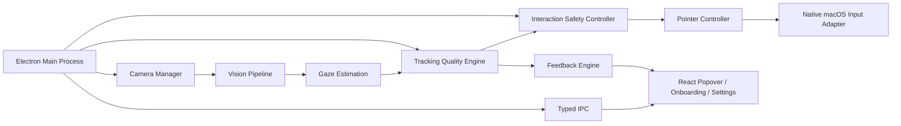
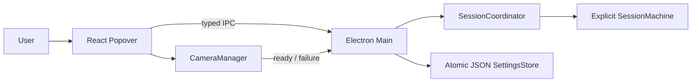

# EyeMouse architecture

## Phase 0 decision

EyeMouse uses a single Electron desktop process with a React renderer and typed IPC. Vision, gaze estimation, quality evaluation, interaction recognition and native input remain replaceable modules behind domain contracts. The first slice intentionally implements only the shell, session lifecycle, camera boundary and preferences.

## Current implemented boundary

The renderer requests camera access through `CameraManager` and runs MediaPipe inference in a bounded worker pipeline. It publishes observations and gesture candidates through typed IPC; it never emits native input. The main process owns lifecycle state, calibration persistence, quality gating, interaction filtering and the native adapter boundary.

The first algorithm packages now exist as executable boundaries:

- `gaze-estimation`: explainable linear/polynomial ridge regression and held-out metrics.
- `calibration`: nine-point fitting targets, held-out validation targets and stable sample collection.
- `tracking-quality`: independent quality dimensions and hysteretic GOOD/DEGRADED/LOST decisions.
- `interaction-engine`: wink/blink rejection, dwell timing and event safety filtering.
- `pointer-controller`: One Euro smoothing, movement policy and native adapter contract.
- `TrackingRuntime`: main-process model prediction, quality evaluation and movement gating.

## Module responsibilities

| Module | Responsibility | Not responsible for |
| --- | --- | --- |
| `shared-types` | Stable IPC and domain contracts | Runtime policy |
| `SessionMachine` | Legal lifecycle transitions | Camera or cursor side effects |
| `SessionCoordinator` | Session status and safety-relevant lifecycle orchestration | Gaze estimation |
| `CameraManager` | Browser camera permission and stream teardown | Facial landmark interpretation |
| `SettingsStore` | Local preferences with atomic writes | Calibration persistence |
| `React renderer` | Camera boundary, worker orchestration, status presentation and user controls | Native input or final safety decisions |
| `TrackingQualityEngine` | Independent quality dimensions and hysteresis | UI rendering |
| `NativeInputAdapter` | Accessibility checks and system events | Gesture recognition |
| `CalibrationStore` | Atomic local calibration profile persistence and display invalidation | Runtime quality decisions |

## Technology decisions

- Electron owns lifecycle, tray and window management.
- React and Vite own renderer composition and development builds.
- TypeScript is strict and shared types define IPC boundaries.
- Vitest covers deterministic state and numerical logic.
- JSON preferences are sufficient for Phase 1. SQLite is deferred until calibration profiles require transactional, queryable storage.
- Electron's login-item API is wrapped at the main-process boundary for Phase 1. Native Service Management integration remains a hardening task and must be verified on signed builds.
- MediaPipe assets and native input are packaged only after the shell can be built and tested independently.

## Non-negotiable safety invariants

1. The renderer cannot call native input directly.
2. No input is enabled by `CAMERA_READY`; active tracking requires later validated calibration.
3. Stopping the session releases camera tracks and emits no further input.
4. The quality engine, not the UI, will decide whether an interaction is safe.
5. Stale observations must never reach a pointer adapter.
